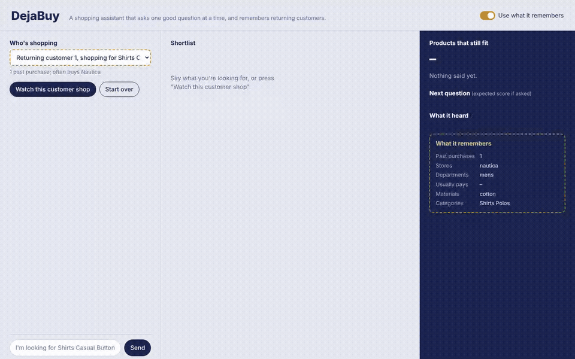
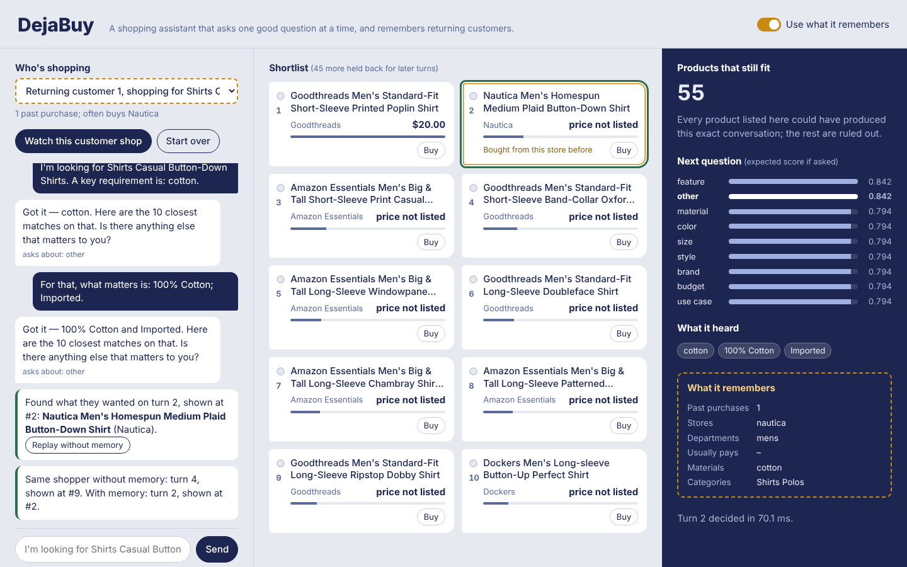

# DejaBuy — 越聊越懂你的记忆型对话导购 Agent

*A conversational shopping copilot that asks one good question at a time — and remembers returning customers.*



在 50,000 件商品的目录上，用 ≤ 10 轮对话把用户想买的那一件推到第一位；对回头客，用他真实的历史购买当先验，第一轮就把他常买的品牌放到前面。

## 结果一览

| 维度 | 设置 | 结果 |
|---|---|---|
| 对话决策 | 官方评测器，200 场公开集 | 综合分 **0.981**（HitRate@10 1.000 / MRR 1.000 / 平均 1.94 轮；官方基线 0.107） |
| 不过拟合 | 两个没调过参的留出集，各 1,200 个新目标 | 均匀抽样 **0.963** · 按真实购买分布 **0.976** |
| 话术鲁棒性 | LLM 改写全部话术（三档，评测器不变） | **0.975 / 0.977 / 0.969** |
| 跨会话记忆 | 真实 Amazon 购买时序，品牌回头客 500 场 | 平均成交轮次 **2.00 → 1.71**（95% CI [−0.35, −0.23]），首轮命中 **36% → 58%**；打乱记忆对照无提升 |
| 记忆不伤人 | 自然分布 2,000 场 | 综合分 0.977 → 0.977；非回头客子集持平 |
| 程序记忆 | 画像模拟器（"从不回答开放式问题"的用户） | 成交轮次 2.46 → 2.14，无此习惯的用户不受影响 |
| 工程 | 默认路径纯标准库、离线可跑 | 每轮 P50 **23 ms** / P95 **65 ms**（20 核桌面 CPU；2 vCPU 云容器 48 / 130 ms），常驻内存 601 MB（含 4.35 万用户的记忆库） |

所有数字都在 `golden/` 里有对应的 JSON，可以一条命令复现（见文末）。

---

## 1. 对话决策：严格环境模型 + 期望效用规划

| 官方评测器，200 场公开集 | 默认配置 | `WIDTH_MODE=product` | `PLANNER=fixed`（无环境模型） |
|---|---:|---:|---:|
| HitRate@10 | **1.000** | 1.000 | 1.000 |
| MRR | **1.000** | 0.731 | 0.884 |
| 平均成交轮次 | 1.94 | 1.48 | 1.94 |
| 综合分 | **0.9812** | 0.9097 | 0.9466 |

按场景：buying 1.43 轮、browsing 1.75 轮、boundary 2.6 轮、intent-override 3.6 轮（改需求在第 3–4 轮才发生），四类 MRR 均为 1.000。

开场品类内的每件商品，都按参考模拟器的规则从商品字段重建隐藏意图卡，把整段对话回放到它身上；回放一致的留下，叫支持集。信念是支持集上证据分的 softmax。决策层对每个可问的属性，按"每个候选会怎么回答"把支持集划成回复组，用官方评分公式算期望效用：现在展示一件（命中即锁定本轮名次），还是推迟（下一轮在它的回复组里的名次，或逐个枚举时的第 1 名）。展示过而未命中的候选随即排除。话术识别不了时事件记 unknown，退回宽松模式（证据排序 + 固定提问），分数回到无环境模型的水平而不是归零。

`benchmark`（默认）和 `product` 是同一引擎的两种展示策略：前者按期望效用决定展示和推迟，基准最优；后者永远展示最可能的 10 件，是真实商店的行为。两个都报。

**留出集**（`bench/synthetic.py`，目标是公开集之外新抽的，所有常数都没在上面调过）：

| 留出集（各 1,200 场） | 综合分 | HitRate@10 | MRR | 平均轮次 |
|---|---:|---:|---:|---:|
| 均匀抽样（多数商品评论少、无标价：长尾） | 0.963 | 0.995 | 0.981 | 2.45 |
| 按真实购买频率抽样（与公开集同分布、新抽） | 0.976 | 1.000 | 0.992 | 2.09 |

## 2. 话术鲁棒性：LLM 结构化抽取 + 目录对齐

理解层三级：模板快路径 → 规则载荷抽取 → LLM 结构化抽取（话语行为 + 逐字片段）。模板之外的每个片段都要对齐到**开场品类的意图卡词表**，事件带"它可能代表的卡片值集合"（`Zipper` → `Zipper closure`，`a Pull-On closure` → `Pull-On closure`，`40 dollars` → `budget around $40.0`，被拆散或打乱顺序的成分表也能拼回去）。严格回放按集合判一致：抽到的能被候选解释即可，抽漏、抽碎都只收窄支持集，不会把真目标剪掉。对齐不上的片段只作软证据，当轮退回宽松模式。开场品类不靠句式猜，直接在句子里逐字扫描目录品类名。

**LLM 改写集**（`bench/paraphrase_llm.py`：deepseek-flash 改写模拟器的每一句话，1,014 条改写 + 884 次抽取全部缓存，无 key 离线复现）：

| 档位 | 含义 | 综合分 | HitRate@10 / MRR | 关掉 LLM 抽取 |
|---|---|---:|---:|---:|
| P1 | 句式改写，约束值与品类逐字保留 | **0.9749** | 1.000 / 0.980 | ≈ 0.955 |
| P2 | 自然说法，短约束可改写，规格串保留 | **0.9769** | 1.000 / 0.987 | ≈ 0.91 |
| P3 | 自然口语，无冒号无列表 | **0.9694** | 0.990 / 0.983 | ≈ 0.90 |

第一版跑出 0.95 / 0.96 / 0.96，用逐场诊断（`bench/paraphrase_diag.py`）找到并修掉：开场品类被句式规则抓错（"browsing for now" → 品类 "now"）、成分表被拆成多个片段、片段裹着填充词、部分抽取被要求与回复完全相等、整句兜底槽位混进事件。

**规则改写集**（`bench/paraphrase_rules.py`，确定性改写，用来分层定位故障点）：

| 档位 | 含义 | 纯规则 | 完美抽取上限（`--oracle`） |
|---|---|---:|---:|
| L1 | 只改句式 | 0.9809 | 0.9799 |
| L2 | + 短约束改成自然说法 | 0.9425 | 0.9791 |
| L3 | + 长规格串重组 | 0.9322 | 0.9787 |
| L4 | 无冒号自然口语 | 0.9487 | 0.9811 |

"完美抽取上限"把 LLM 层换成按改写模板反推的完美抽取：抽取层之后的流水线已经没有悬崖，真实 LLM 离上限约 0.01。

## 3. 跨会话记忆

### 数据与基准（`scripts/scan_sequences.py` → `scripts/filter_meta.py` → `bench/memory/build.py`）

- Amazon Reviews 2023 Clothing 全量评分记录（6,500 万条）里，**94 万**用户买过本目录的商品且之前还有购买记录；他们的历史涉及 166 万件目录外商品，属性从官方元数据里筛出。
- 一个用户一场会话：目标是他最后一次买的目录商品，记忆是**严格早于**这次购买的全部记录（按时间切分，无泄漏）。按用户哈希分 train 4 万 / dev 1,000 / test 2,000，用户不跨集合；每件商品每个集合最多出现 3 次（一件 T 恤是 18 万人的"最后一次购买"，不设上限就只在测爆款）。
- 品牌回头客在自然分布里只占约 6%，另建 `test_loyal`（500 场，test 用户、与 test 不重叠）单独报告。

### 先验怎么学（`dejabuy/memory/semantic.py`、`scripts/train_memory.py`）

语义画像是按时间衰减（半衰期 365 天）的属性分布：品牌、性别线、价位、材质颜色、意图卡值、品类，加上"重复购买同一品牌的比例"。先验是逐候选亲和特征的线性分，作为条件 logit（在目标品类的候选池上做多项选择）在 train 上学；特征子集和 L2 用事先定好的规则在 dev 上选。每个特征在历史里没有对应信号时都为 0，所以没有可用信号的用户拿到的就是冷启动排序——门控是结构性的。

置换分析（本人历史 vs 随机他人历史）显示信号几乎全在品牌复购上；材质、颜色、意图卡值只带来噪声，最终模型只保留品牌、品牌忠诚度、性别线和价位。

**单次排序**（目标在其品类候选池里的名次，不对话；test 2,000 场）：

| | 冷启动 | 本人记忆 | 打乱记忆（对照） |
|---|---:|---:|---:|
| 全体 MRR | 0.415 | **0.431** | 0.403 |
| 品牌回头客 MRR（test_loyal 500） | 0.426 | **0.712** | 0.418 |
| 品牌回头客 进前 10 | 69.8% | **88.0%** | 69.4% |
| 非回头客 MRR | 0.427 | 0.427 | 0.415 |

### 整段对话（`bench/memory/run.py`，官方评测器协议，只改 agent 被告知的用户身份）

| | 冷启动 | 本人记忆 | 打乱记忆 | 记忆 − 冷启动（95% CI） |
|---|---:|---:|---:|---:|
| **品牌回头客 500 场**：平均成交轮次 | 2.002 | **1.714** | 2.010 | **−0.288** [−0.350, −0.230] |
| 　首轮命中率 | 36.4% | **58.4%** | 35.0% | |
| 　MRR | 0.987 | **0.998** | 0.984 | +0.011 [+0.003, +0.021] |
| **自然分布 2,000 场**：平均成交轮次 | 2.015 | 1.994 | 2.026 | −0.016 [−0.034, +0.002] |
| 　综合分 | 0.9771 | 0.9772 | 0.9768 | |
| 　其中品牌回头客 127 场：轮次 / 首轮命中 | 2.10 / 34% | **1.84 / 54%** | 2.16 / 31% | |
| 　其中其余 1,873 场：轮次 | 2.01 | 2.01 | 2.02 | |

结论：记忆对认得的人（品牌回头客）帮助很大，对其余人既不帮也不伤；自然分布里整体只省约 1% 的轮次，是因为品牌回头客只占 6%。和打乱记忆比，全体的轮次差 −0.027 [−0.045, −0.008] 不跨 0。

### 程序记忆（`dejabuy/memory/procedural.py`、`bench/memory/persona.py`）

记录"这个用户问什么会答、问什么会拒答"（Beta-Binomial 估计每个属性的回答概率）。规划器把拒答的问题当作"花一轮、什么都没划分"，按回答概率折算提问的期望效用。会话内单次拒答不算习惯（参考模拟器的 boundary 场景本来就会拒答第一个问题一次），同一属性被拒两次才生效；跨会话的每次回答都记下。

参考模拟器没有用户级习惯，所以用一个只加了一种习惯的画像模拟器测：一半用户"从不回答开放式问题"（每次问 other 都回 boundary 句），一半正常。每个用户先聊一场别的商品，再测真正的目标（语义记忆两组都关掉）：

| 400 个用户 | 只有会话内适应 | + 跨会话程序记忆 |
|---|---:|---:|
| 不答开放式问题的用户：平均轮次 | 2.46 | **2.14** |
| 正常用户：平均轮次 | 1.89 | 1.89 |

这是按构造的模拟器，证明的是机制和它在习惯存在时值多少，不代表真实用户里有多少人有这个习惯。

## 4. 消融（官方公开集，每行只改一个开关）

| 去掉的部分 | 综合分 | MRR | 平均轮次 | 说明 |
|---|---:|---:|---:|---|
| （完整系统） | **0.9812** | 1.000 | 1.94 | |
| 环境模型 + 期望效用规划（`PLANNER=fixed`） | 0.9466 | 0.884 | 1.94 | 最大的单项贡献 |
| 展示 / 推迟决策（`WIDTH_MODE=product`） | 0.9097 | 0.731 | 1.48 | 永远展示 10 件：更快命中但名次差 |
| 热度先验 | 0.9777 | 0.996 | 2.06 | 支持集内排序主要靠它 |
| 标价先验 | 0.9806 | 1.000 | 1.97 | |
| 意图卡一致性 / 短语召回 | 0.9812 | 1.000 | 1.94 | 公开集上走严格路径，用不到；见下表宽松路径 |
| 信念温度 ×0.5 / ×2 | 0.9811 / 0.9812 | 1.000 | 1.95 / 1.94 | 对温度不敏感 |
| 前瞻只看前 50 个候选 | 0.9811 | 1.000 | 1.95 | 剪枝几乎无损 |

宽松路径（规则改写集 L3，关掉 LLM 抽取，多数会话退到证据排序）上的同一组消融：

| 去掉的部分 | 综合分 | MRR | 平均轮次 |
|---|---:|---:|---:|
| （完整系统，纯规则） | **0.9322** | 0.881 | 2.10 |
| 热度先验 | 0.8961 | 0.822 | 2.40 |
| 意图卡一致性 | 0.9307 | 0.876 | 2.10 |
| 短语召回 | 0.9322 | 0.881 | 2.10 |

短语召回在两条路径上都测不出作用（它是严格回放出现之前为个别长尾样本加的召回补丁），保留但不再算作贡献。

## 5. 延迟、内存与稠密召回

官方评测器逐轮计时（`bench/latency.py`，2 vCPU 云容器，单进程，LLM 抽取层不触发；常驻内存 = agent 构建完成后的进程峰值 RSS，不含评测器自己加载的目录）：

| 配置 | 轮数 | P50 | P95 | P99 | 常驻内存 |
|---|---:|---:|---:|---:|---:|
| 默认，公开集（全部走严格路径） | 388 | 47.9 ms | 130.4 ms | 174.5 ms | 601 MB |
| 同上，**20 核 Windows 桌面机**（启动 10.1 s） | 388 | **22.6 ms** | **65.2 ms** | 77.7 ms | — |
| 默认，均匀留出集 | 2,929 | 55.3 ms | 124.6 ms | 163.3 ms | 600 MB |
| 默认，规则改写 L3（38% 的轮次走宽松路径） | 416 | 76.0 ms | 143.1 ms | 162.4 ms | 600 MB |
| 关掉记忆（`MEMORY=0`），公开集 | 388 | 50.1 ms | 130.3 ms | 155.8 ms | 349 MB |
| 打开稠密路（`USE_DENSE=1`），公开集 | 388 | 69.9 ms | 149.4 ms | 183.3 ms | 770 MB |
| 打开稠密路，规则改写 L3 | 408 | 99.9 ms | 180.2 ms | 226.4 ms | 770 MB |

启动（目录索引 + FTS5 + 记忆库）云容器约 18 秒、桌面机 10 秒。记忆库只保留运行时用到的字段并做字符串驻留，占约 250 MB；延迟与是否开记忆无关。

**稠密召回**（`scripts/build_dense.py`、`bench/dense_eval.py`）：bge-small-en-v1.5 导出 ONNX 后做动态 INT8 量化，133 MB → 34 MB，和 fp32 在 256 件商品上的平均余弦 0.978、最近邻一致率 81.6%；5 万件商品的向量以 float16 存盘，40 MB。稠密路只把 BM25 漏掉的商品追加到候选池末尾，不动原有顺序。

| 纯规则，200 场 | 综合分 关 → 开 | 首轮候选池含目标 关 → 开 | 全部轮次候选池含目标 关 → 开 |
|---|---:|---:|---:|
| 原话术（L0） | 0.9812 → 0.9812 | 55.5% → 67.5% | 74.5% → 81.2% |
| 规则改写 L2 | 0.9425 → 0.9444 | 56.0% → 66.5% | 68.0% → 77.1% |
| 规则改写 L3 | 0.9322 → 0.9341 | 55.5% → 66.5% | 66.1% → 75.2% |
| 规则改写 L4 | 0.9487 → 0.9484 | 51.5% → 63.5% | 64.8% → 73.2% |

召回涨了 10–12 个百分点，端到端几乎不变：严格路径的支持集取自整个开场品类，本来就不依赖候选池；宽松路径上，L3 有 25 场的目标只靠稠密路进池，但命中只多了 1 场——追加进来的商品在证据打分里排不进前 10。代价是每轮多 20–35 ms、多 170 MB 内存，所以默认关闭，作为可选路由保留。bge-base 的对照尚未做（模型 436 MB）。

## 6. Demo 与 REST 服务

```bash
python -m dejabuy.server            # http://127.0.0.1:8000
```

单页 demo：选一个回头客（来自 `test_loyal` 的真实用户），点"Watch this customer shop"让参考模拟器扮演他，逐轮看到 agent 的提问、10 件候选（每件的相对可能性、是否因为"买过这个品牌"被记忆抬高）、还剩多少商品与对话一致、每个可问属性的期望得分、它记得这个人什么；结束后可以"Replay without memory"对比。也可以自己打字聊，点 Buy 把购买写进记忆。

| 接口 | 作用 |
|---|---|
| `GET /api/customers` | demo 用户（新用户 + 回头客） |
| `POST /api/session` `{customer_id?, memory?}` | 开一场会话，返回记忆摘要 |
| `POST /api/turn` `{session_id, message}` | 一轮：回复、提问属性、决策记录（候选、信念、效用、延迟） |
| `POST /api/simulate` `{customer_id, memory?}` | 参考模拟器扮演该用户，整场对话逐轮返回 |
| `POST /api/buy` `{session_id, parent_asin}` | 写入购买记忆 |
| `POST /api/forget` `{customer_id}` | 删除该用户的全部记忆 |



## 快速开始

Python 3.13 / 3.14 下测试通过。默认路径（评测、记忆、demo）只用标准库；可选功能的依赖见 `requirements-optional.txt`。LLM 抽取层需要 DeepSeek key：复制 `.env.example` 为 `.env` 填入，不填则自动退回规则路径。

```bash
python scripts/prepare_catalog.py               # 校验并解压目录（一次）
python -m scripts.run_eval                      # 官方评测 → 0.9812
python -m unittest discover -s tests            # 单测
python -m dejabuy.server                        # demo

# 话术鲁棒性
python bench/paraphrase_llm.py                  # P1–P3（缓存齐全时无 key 可跑；LLM_PARSE=0 为纯规则消融）
python bench/paraphrase_rules.py [--oracle]     # L0–L4
python bench/paraphrase_diag.py --level P1      # 逐场诊断

# 记忆（数据管线：scan_sequences → filter_meta → build；benchmark 数据已随仓库提供）
python -m scripts.train_memory                  # 学先验 → data/memory_weights.json（dev 选型）
python -m bench.memory.run --split test_loyal   # 整段对话：冷启动 / 记忆 / 打乱记忆
python -m bench.memory.persona                  # 程序记忆

# 其他
python -m bench.synthetic                       # 留出集
python -m bench.ablations                       # 消融矩阵
python -m bench.latency                         # 延迟与内存
python -m scripts.build_dense                   # INT8 稠密索引（需 data/onnx_model/）
python -m bench.dense_eval                      # 稠密路开 / 关对比 + 候选池召回
```

## 架构

```
用户话术 ─► L1 理解（模板 → 规则 → LLM 结构化抽取 → 目录对齐 → 协议事件 / 集合值事件）
              │
              ▼
L0 环境模型 ◄─ L2 信念（FTS5 ∪ 短语召回 ∪ 稠密 → 证据打分 + 购买先验 + 记忆先验 → P(target=i)）
 严格协议回放   │            ▲
              ▼            │ L5 记忆：情景（购买 / 会话） → 语义画像（衰减分布 → 学到的先验）
           L3 决策（期望效用：问哪个属性 / 展示 / 推迟；程序记忆折算回答概率）
              ▼
           L4 表达 + 决策记录（trace / REST / demo）
```

```
dejabuy/
  agent.py · server.py · static/      入口（evaluator 接口） · REST + demo
  understand/   rules · canonical · verify · llm_extract · normalize
  env/          protocol（严格回放）
  belief/       retrieve · evidence · belief · dense · prior
  decide/       planner · utility · width
  memory/       store · episodic · semantic · procedural · items · session
  llm/          client（标准库 HTTP，JSON 模式，落盘缓存，熔断）
bench/          paraphrase_* · memory/{build,run,persona} · synthetic · ablations · latency · dense_eval
scripts/        prepare_catalog · scan_sequences · filter_meta · train_memory · build_dense · run_eval
golden/         所有报告数字的 JSON
docs/           demo 截图 · 官方赛题文档
```

## 配置（环境变量，默认值都是测过的）

| 变量 | 默认 | 作用 |
|---|---|---|
| `PLANNER` | `utility` | `fixed` = 无环境模型的固定策略 |
| `WIDTH_MODE` | `benchmark` | `product` = 永远展示最可能的 10 件 |
| `BELIEF_TEMPERATURE` | `1.0` | 支持集信念的 softmax 温度 |
| `PLAN_MASS` / `PLAN_TOP` | `0.999` / `600` | 前瞻剪枝 |
| `LLM_PARSE` | `1` | LLM 抽取层（无 key 自动退回规则；公开集零触发） |
| `LLM_MODEL` / `LLM_CACHE_PATH` | `deepseek-flash` / `data/llm_cache.jsonl` | |
| `MEMORY` / `MEMORY_DIR` / `MEMORY_WEIGHTS` | `1` / `data/memory_bench` / `data/memory_weights.json` | 跨会话记忆（`user_profile` 带 `user_id` 才生效） |
| `MEMORY_SCALE` / `MEMORY_HALF_LIFE` | `1.0` / `365` | 记忆先验整体缩放 · 衰减半衰期（天） |
| `PROCEDURAL` | `1` | 程序记忆 |
| `USE_DENSE` / `EMBED_ONNX_MODEL` | `0` / `model_int8.onnx` | 稠密召回路（INT8 ONNX；召回 +10 pt，端到端持平，默认关） |
| `POP_WEIGHT` / `HAS_PRICE_WEIGHT` / `MIRROR_BONUS` / `PHRASE_RECALL` | `2.75` / `0.95` / `1.0` / `1` | 购买先验 · 意图卡一致性 · 短语召回 |

## 数据

目录、公开集与评测器为 TikTok TechJam 2026 赛题官方资产，原样使用。记忆基准派生自 Amazon Reviews 2023（McAuley Lab, UCSD）的评分记录与商品元数据。
